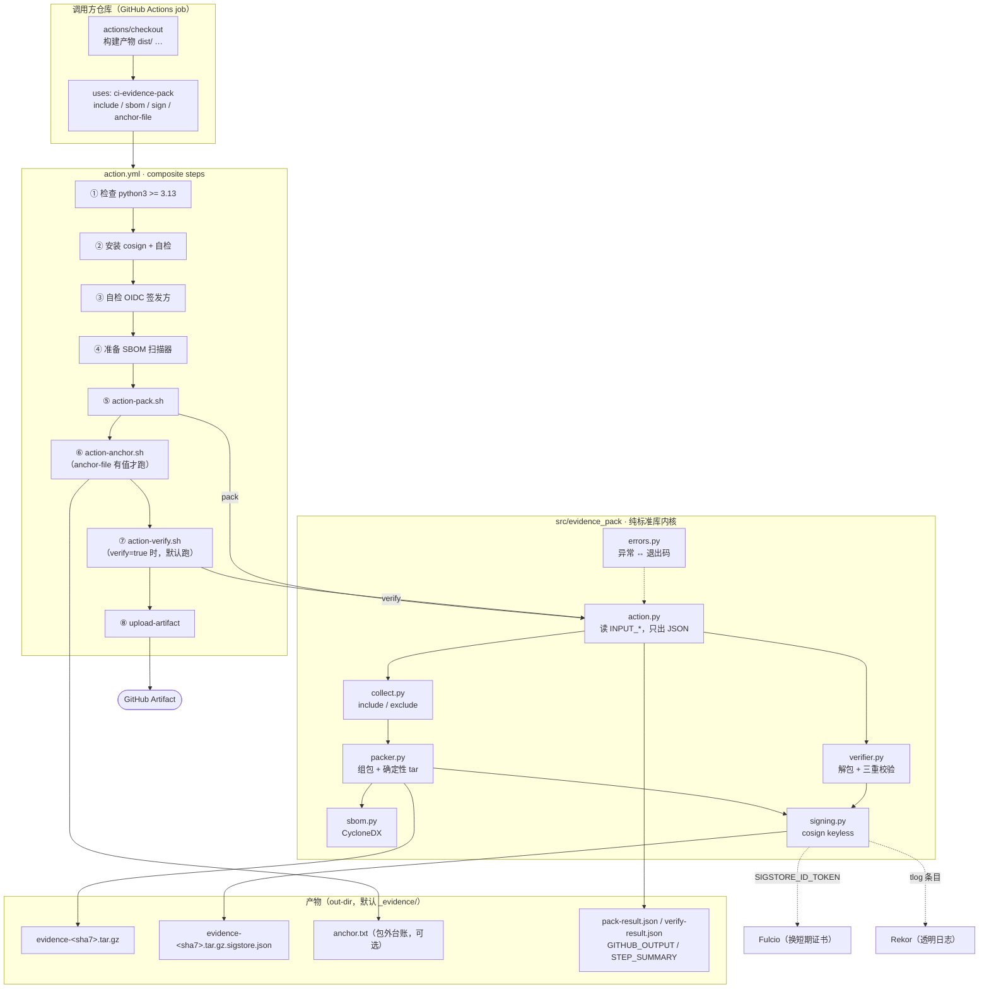
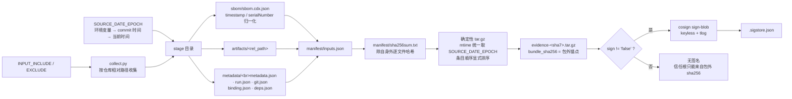
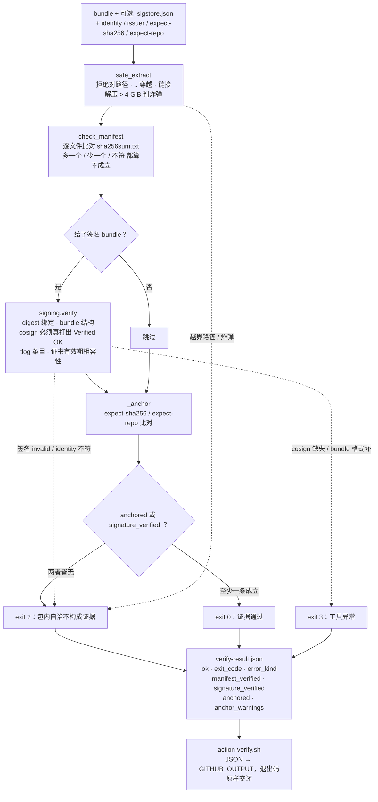
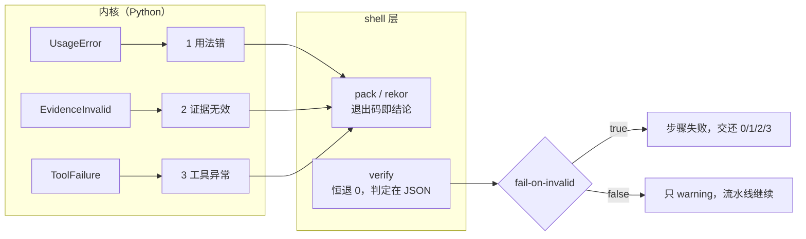

# evidence-pack

**一个 GitHub Action**：把一次 CI 构建钉成一份可独立验证的证据包 ——
确定性打包、严格 manifest、cosign 短期证书签名、退出码 0/1/2/3 分层。

一句话说清它守的是什么：

> 包里的 `manifest/sha256sum.txt` 只能证明包内自洽 —— 谁都能改内容再重算哈希。
> 证据的信任根必须来自**包外**：签名，或者调用方手里的锚点。两者都没有，
> 判定为 2，不吐绿。

> 灵感来自 [OrygnsCode/ci-evidence-pack](https://github.com/OrygnsCode/ci-evidence-pack)（MIT）。
> 只沿用思路（确定性打包、严格解包、双输出模式），签名层与内核全部重写。

## 只有一个入口：Action

本仓库**没有命令行程序**。它只做一件事：在 GitHub Actions 里被 `uses:` 调用。

```yaml
- uses: xiaomizhoubaobei/ci-evidence-pack@6d8ae66b768b8a77fb691fcb88729c8fc13dd912
  with:
    include: |
      dist/
      pyproject.toml
```

要验收据包的第三方也不必装任何依赖：环境需 Python 3.13+，检出本仓库跑 `scripts/action-verify.sh`
（见「只校验、不打包」）。别的 CI 环境（CNB / GitLab）可以借用同一个内核
（`python3 -m evidence_pack.action`，环境需 Python 3.13+，输入走 `INPUT_*` 环境变量，接法见
[`docs-usage.md`](docs-usage.md)）；但仓库本身不再养一层命令行外壳 ——
参数解析、双输出模式在这里没有第二个使用者，只会多一份要跟着内核改、
却没人跑的外壳。

## 三条硬规矩

| 规矩 | 落地方式 |
|---|---|
| 信任根必须在包外 | 无签名且无包外锚点时判 2 |
| 退出码语义不许混 | 2 = 证据无效（有人动过手脚），3 = 工具异常（流水线坏了） |
| 确定性优先 | 时间戳统一取 `SOURCE_DATE_EPOCH`，文件排序显式指定 |

签名只有一种签法：用本次构建的 OIDC token 向 Fulcio 换一张十分钟就过期的短期证书。
项目里**没有**长期私钥这条路 —— 一把永不过期、泄露即永久被冒充的私钥，
不该成为「拿不到 OIDC 时自动生效」的备选。想不签，得显式说 `sign: 'false'`，
并自备包外 sha256 锚点。

## Action 会做的事

按顺序，全部由 `action.yml` 的 composite steps 完成：

1. 检查 `python3 >= 3.13`（内核纯标准库，这一步不装任何包）
2. `sign != 'false'` 时装 cosign，并拿 OIDC 换短期证书（缺签发方直接判 3）
3. 打包 → 证据包 + `.sigstore.json`
4. `anchor-file` 有值时把 sha256 追加登记（包外台账）
5. `verify: true`（默认）自检：有签名验签名，没签名则以 `expect-sha256` 为锚点
6. `upload-artifact: true`（默认）把包、签名、台账一起上传

产物两份，都在 `out-dir`（默认 `_evidence`）下：

```
evidence-<sha7>.tar.gz                 证据包
evidence-<sha7>.tar.gz.sigstore.json   签名 bundle（未签名时不存在）
```

验签需要 `cosign` v3+ 在 PATH 上（Action 会自己装）；SBOM 需要
`cyclonedx-py` / `cyclonedx-npm`（Action 会按项目类型补装，两个都缺席时
Python 项目退回内置解析，不静默出空 SBOM）。

### 结构化输出

Action 的结论既写进 outputs，也是内核 stdout 上的 JSON（`pack-result.json`）。
打包侧关键字段：

| 字段 | 含义 |
|---|---|
| `bundle_path` / `bundle_name` | 包的位置与文件名 |
| `bundle_sha256` | **包外锚点就是它** |
| `file_count` | 包内文件数（不含 manifest 自身） |
| `source_date_epoch` | 这次打包用的确定性时间戳 |
| `signed` / `signature_mode` | 是否签成、模式（恒为 `keyless`） |
| `signature_bundle` | `.sigstore.json` 路径 |
| `certificate_identity` / `certificate_issuer` | token 里的 `sub` / `iss`（回显便于核对） |
| `cert_not_before` / `cert_not_after` | 短期证书的有效期窗口 |

校验侧的 JSON（`verify-result.json`）：

| 字段 | 含义 |
|---|---|
| `ok` / `exit_code` | 结论（语义见「退出码」），成功失败**都有** |
| `error` / `error_kind` | 失败原因；成功时是 `null`，键一直在，不必猜 |
| `manifest_verified` | 包内逐文件哈希是否对得上 |
| `signature_verified` | 签名**真的验过**没有（不只是「有签名」） |
| `tlog_checked` | 透明日志条目查没查 |
| `anchored` | 包外锚点是否核对通过 |
| `anchor_warnings` | 锚点没能真正核对的说明（不是失败，是「这条锚点没起作用」） |
| `repo` / `file_count` / `source_date_epoch` | 包内记录的回显 |

## 退出码

| 码 | 含义 | 触发点 | 该怎么办 |
|---|---|---|---|
| 0 | 证据通过 | 全绿，且有签名或包外锚点 | 绿灯 |
| 1 | 用法错误 | `include` 为空 / 不存在、要签名却没 token、缺期望身份、`SOURCE_DATE_EPOCH` 非法 | 修配置，与证据真伪无关 |
| 2 | 证据无效 | 哈希不符、签名 invalid、identity 不匹配、锚点不符、无信任根 | 有人动过手脚，停止发版 |
| 3 | 工具异常 | `cosign` 缺失、bundle 格式坏、SBOM 要而不得、OIDC 换不到 token | 别信结论，先修环境 |

2 与 3 分开是刻意的：一个要追责，一个要修流水线，人工处置完全不同。

## 参数怎么进内核

Action 的每一步都是 shell 调内核：

```bash
python3 -m evidence_pack.action pack      # 读 INPUT_* 环境变量，输出 pack-result.json
python3 -m evidence_pack.action verify    # 恒退出 0，判定在 JSON 的 exit_code 里
python3 -m evidence_pack.action rekor     # 从签名 bundle 里读透明日志条目
```

`pack` / `rekor` 的进程退出码就是结论（0/1/3）；`verify` 恒为 0 ——
Action 要先拿到判定再做决策（登记锚点、上传制品、发评论），
不能让一个非零退出码在 `set -e` 下把后续步骤全掐掉。什么时候真的红，
由 `fail-on-invalid` 说了算。

输入全走环境变量（与 Action 的 `INPUT_*` 一一对应）：

| 环境变量 | 说明 |
|---|---|
| `INPUT_INCLUDE` | 必填，一行一个，空行与 `#` 注释忽略，行首尾空白裁掉 |
| `INPUT_EXCLUDE` | 额外排除的目录名（默认已排除 `.git` / `node_modules` / `dist` / `__pycache__` / `.venv` / `venv`） |
| `INPUT_SBOM` | `auto` / `none` / `python` / `node`，默认 `auto` |
| `INPUT_OUT_DIR` | 输出目录，会被自动排除在收集范围外 |
| `INPUT_BUNDLE_NAME` | 包名，脚本给默认值 `evidence-<sha7>.tar.gz` |
| `INPUT_SIGN` | **唯一的签名开关**，只有小写 `'false'` 才算关 |
| `INPUT_IDENTITY` / `INPUT_ISSUER` | 期望身份，只写进包内 `metadata/binding.json`，不是签名开关 |
| `SIGSTORE_ID_TOKEN` | OIDC token。只从这里读，绝不进 argv |
| `SOURCE_DATE_EPOCH` | 打包时间戳；不给则取该 commit 的时间，无 git 时才用当前时间 |

几个必须判 1（用法错，与证据真伪无关）的情形：

- `include` 一个都没给，或给了但路径不存在 / 匹配不到文件；
- `include .` —— 会把整个仓库连同输出目录一起装进去；
- 路径落在 `.git` 或输出目录内 —— `.git` 里没有可复现的东西，输出目录收进来会让包越滚越大；
- 要签名却没有 `SIGSTORE_ID_TOKEN` —— 那是「你没给身份」，不是「工具坏了」；
  等 token 换不到证书时，才是 3；
- `sbom: python|node` 与实际项目类型冲突，或值不在 `auto/none/python/node` 里；
- `SOURCE_DATE_EPOCH` 不是正整数。

### 校验侧的样子

内核只认这几样：包路径、签名 bundle、期望身份、包外锚点。

- `identity` / `issuer` 没给时，用包内 `metadata/binding.json` 的声明兜底；
  **兜底后仍缺一个** → 判 1（等于接受任何人的签名）。
- `binding.json` 是打包方自己写的**声明**，随包一起送来，谁改了包谁就能改它。
  它的作用是「省略时有个默认期望值」，不是信任根 —— 真正的信任来自
  cosign 对证书链与 tlog 的校验。

### `rekor` 子命令

```bash
INPUT_SIGNATURE_BUNDLE=evidence.tar.gz.sigstore.json \
PYTHONPATH=$ACTION_PATH/src python3 -m evidence_pack.action rekor
```

列出签名 bundle 里的透明日志条目：`log_index` / `log_id` / `integrated_time` / `url`。
查询地址落在**条目 uuid** 上（`/api/v1/log/entries/<entryUUID>`），不落在序号上 ——
`?logIndex=N` 是给人翻页的过滤参数，不是定位符；`logId.keyId` 是**日志**公钥的摘要，
拿它拼地址会打得开、但打不开对应条目。取不到 uuid 时宁可只给序号，也不给一个像模像样的死链。

三种情形分开说：有条目 → 任何人可独立复核；签名了但无 tlog 条目 → **不能单独构成证据**（验签判 2）；
本次未签名 → 没有透明日志条目，信任根只有正文里的 sha256 锚点。

## 签名与验签

### 信任根是那对 (identity, issuer)

1. 平台给流水线一张 OIDC token，`sub` 写着「谁在跑」（workflow 路径 + ref），`iss` 写着「谁签发的」；
2. cosign 拿 token 找 Fulcio 换一张十几分钟就过期的证书，私钥当场生成、签完即弃；
3. 签名连同证书链、Rekor 条目一起封进 `.sigstore.json`。

所以身份不是密钥。identity 请写死到**具体流水线文件**，别用通配 ——
宽匹配等于让别人拿同一 issuer 下的任意 workflow 冒充你。`@` 后面那截跟着 ref 走：
写死 `@refs/heads/main` 的流水线在 tag 上必然判 2，那不是配置笔误，是「签名身份不是我以为的那个」。

token 只经 `SIGSTORE_ID_TOKEN` 进 cosign 子进程，**从不拼进 argv**。

### 验签不信退出码

原实现是「`cosign` 返回 0 就算验过」，于是一个 `exit 0` 的假 cosign 就能骗过它。
这里除退出码外，还独立核对：

1. bundle 的内容摘要 == 被打包文件的摘要（digest 绑定）；
2. bundle 结构合法（有 `messageSignature` 或 DSSE 信封）；
3. cosign 必须真的打出 `Verified OK`；
4. bundle 里确有 tlog 条目，除非调用方显式关掉 tlog 校验（`ignore-tlog`）。

再加一条时间相容性：Rekor 记录的签名时刻若落在证书有效期之外，判 2 ——
那不是这张证书签的。

签出的 bundle **必须**带证书链和 tlog 条目，缺一样判 3（Fulcio/Rekor 没通）。

### `metadata/binding.json` 不是信任根

打包时给的 `identity` / `issuer` 会被写进包内 `binding.json`。
它是打包方**声明**的期望身份，可以被伪造，所以只在校验侧没显式给身份时用来填空。

## SBOM

`sbom: auto` 认出项目类型：
`pyproject.toml` / `setup.py` / `requirements.txt` / `poetry.lock` → python，`package.json` → node，
都认不出 → `none`（不判错）。

Python 侧依赖清单的取值顺序：`cyclonedx-py`（有 `poetry.lock` 或 `requirements.txt` 时）→
`requirements.txt` 内置解析 → `pyproject.toml` 的 PEP 621 依赖表。明确要了却拿不到 → 判 3，
绝不静默出个空 SBOM。

扫描器自带的 `metadata.timestamp` 与 `serialNumber` 会被归一化：前者取 `SOURCE_DATE_EPOCH`，
后者由内容派生 —— 否则同一个 commit 打两次包会得到两个哈希，可复现就是句空话。

## 包内布局

```
artifacts/<rel_path>         include 收进来的文件，保留仓库内相对路径
metadata/metadata.json       工具名、版本、format_version、SOURCE_DATE_EPOCH
metadata/run.json           CI 上下文（GitHub / CNB / GitLab，采到什么记什么）
metadata/git.json           HEAD sha、分支、remote_url、describe、dirty（非 git 仓库则不产）
metadata/binding.json       声明的期望身份（给了 identity / issuer 才有）
metadata/deps.json          SBOM 形态（产出 SBOM 时才有）
sbom/sbom.cdx.json          CycloneDX
manifest/inputs.json        收进来的文件清单，以及被排除规则挡下的路径（skipped）
manifest/sha256sum.txt      除自身外每个文件的 sha256（严格模式的依据）
```

解包侧只接受普通文件和目录：绝对路径、`..` 穿越、符号链接、硬链接、设备文件一律拒绝，
解压总量超 4 GiB 判解压炸弹 —— 证据包是别人给你的，解包环节本身就是攻击面。

## 作为 GitHub Action

```yaml
permissions:
  contents: read
  id-token: write          # 签名的全部信任根：没有它就换不到 OIDC token

steps:
  - uses: actions/checkout@v4
  - uses: xiaomizhoubaobei/ci-evidence-pack@6d8ae66b768b8a77fb691fcb88729c8fc13dd912
    id: evidence
    with:
      include: |
        dist/
        configs/
      sbom: auto
      # identity 留空 = 按本次触发的 repository + workflow + ref 自动拼
      anchor-file: _evidence/anchor.txt
      expect-repo: ${{ github.repository }}
```

| 输入 | 默认 | 说明 |
|---|---|---|
| `include` | 必填 | 一行一个，支持 `#` 注释 |
| `exclude` | 空 | 额外排除的目录名 |
| `sbom` | `auto` | `auto` / `none` / `python` / `node` |
| `out-dir` | `_evidence` | 输出目录 |
| `bundle-name` | `evidence-<短sha>.tar.gz` | 包名 |
| `sign` | `'true'` | 只有小写 `'false'` 才算关。条件传值用 `cond && 'false' \|\| ''`，别直接传 outputs（会渲染成 `'False'`） |
| `identity` / `issuer` | 按触发 ref 自动拼 / GitHub OIDC | 期望签发身份 |
| `verify` | `true` | 打完包立刻自检 |
| `expect-sha256` / `expect-repo` | 空 / `github.repository` | 包外锚点 |
| `anchor-file` | 空 | 追加登记 sha256 的文件（包外台账） |
| `upload-artifact` / `artifact-name` | `true` / 包 sha 前 16 位 | 是否上传、传成什么名字 |
| `retention-days` | `30` | artifact 保留天数 |
| `fail-on-invalid` | `true` | 自检结论为 2/3 时是否让步骤失败 |

主要 output：`bundle-path` / `bundle-name` / `bundle-sha256` / `signature-bundle` /
`signature-mode` / `signed` / `signature-verified` / `anchored` / `verify-ok` /
`verify-exit-code` / `verify-error` / `file-count` / `source-date-epoch` / `artifact-name` / `anchor-file`。

Action 是 composite 的：不往调用方的解释器里 `pip install`，只把本仓库的 `src` 塞进 `PYTHONPATH`。
内核纯标准库，连参数解析都自己读环境变量 —— 少一个依赖，就少一处会随 runner 环境变化的地方。
cosign 默认就装，只有 `sign: 'false'` 才跳过。

### 只校验、不打包

验收据包的一方不需要打包能力：检出本仓库，调 `scripts/action-verify.sh`。
`ACTION_PATH` 必须指向 **evidence-pack 仓库的检出位置**，不能填自己的 workspace。

```yaml
- uses: actions/checkout@v4
  with:
    repository: xiaomizhoubaobei/ci-evidence-pack
    path: .evidence-pack

- shell: bash
  env:
    ACTION_PATH: ${{ github.workspace }}/.evidence-pack
    INPUT_BUNDLE: _evidence/evidence-abc1234.tar.gz
    INPUT_SIGNATURE_BUNDLE: _evidence/evidence-abc1234.tar.gz.sigstore.json
    INPUT_IDENTITY: https://github.com/org/repo/.github/workflows/ci.yml@refs/heads/main
    INPUT_ISSUER: https://token.actions.githubusercontent.com
    INPUT_EXPECT_SHA256: ${{ vars.EVIDENCE_ANCHOR }}
  run: bash "$ACTION_PATH/scripts/action-verify.sh"
```

它同样只出结论（JSON + `GITHUB_STEP_SUMMARY`），进程退出码保留 0/1/2/3 的语义。

### 自检通过 ≠ 包外那份账对上了

`expect-sha256` 留空时，Action 回送的是**本 job 上一步刚算出来的**摘要。
签名默认开启之后这条路必然走成 0 —— 它验的是「刚打出来的东西」，不是「包外登记过的那份账」。

所以请把 `verify-ok` 读成「产物在步骤之间没被动过」，别读成「这份包来自我以为的那个人」。

`anchor-file` 也**不是**信任根，它只是本 job 顺手写下的一行台账 —— 未经登记就拿回来核对，
等于用自己刚产出的摘要给自己发证。它要变成锚点，得先被搬到包外一个受保护、不可变、
调用方读得到但改不了的地方（审计库、制品库的元数据、Release 正文、工单），
下一次核验再从**那里**取回来当 `expect-sha256` 用。
真正的信任根只有两条：签名里的 `identity`，或已登记到包外的那份 sha256。

### OIDC 权限

`id-token` 默认是 `none`，且 **job 级 `permissions` 一旦写了就是白名单**：
顶层给了 `id-token: write` 不算，job 里重写 `permissions` 会把它覆盖掉。

| 情况 | 怎么办 |
|---|---|
| GitHub 托管 runner | 加 `id-token: write`，OIDC 换短期证书 |
| 自托管 / 本地，没有 OIDC 签发方 | 显式 `sign: 'false'`，并自备包外 sha256 锚点 |

两条路都不走又不肯关签名，Action 会以退出码 3 报出「缺 OIDC token」，而不是静默不签 ——
一份「以为签了其实没签」的证据，比没有证据更危险。

顺带澄清一个坑：`ACTIONS_ID_TOKEN_REQUEST_TOKEN` 是**换 token 的凭据**，不是 token 本体。
把它当 token 用，Fulcio 只会回 401，现场看起来跟「`id-token: write` 没开」一模一样。
判据必须是「有没有签发方」。

### 关于 `expect-repo` 的边界

包内若记了 git remote，就据此核对，不符判 2 —— 这条没得商量。
包内没有 remote 元数据时（`actions/checkout` 的默认检出、剥离了 `.git` 的构建上下文），
**不把它当篡改** —— 不会报「锚点不符」，因为缺元数据是采集环境的问题。
后果要说实话：**这条锚点等于不生效**，`anchored` 保持 `false`。
这里有个容易读反的地方，两条路径分开说：

| 路径 | `anchor_warnings` | 说明 |
|---|---|---|
| 普通成功（无签名，但 `expect-sha256` 对上） | **有**这条 warning | 结果里 `anchored=true`（靠 sha256），同时如实记下 `expect-repo` 没起作用 |
| 因无信任根判 2（`exit_code=2`） | **没有**这条 warning | 失败结果只填 `error`/`error_kind`，`anchor_warnings` 是空列表；错误正文也不会点名 `expect-repo` |

换句话说：warning 只在「结论仍然是绿的」时候出现，提醒你绿得没那么足；
真判了 2，就不要指望从 warning 里找细节，细节不在那儿。

想要一条真能核对的锚点：用 `expect-sha256`，别指望 `expect-repo`
在没有 remote 的检出里替你兜底。

## 架构图

先给全景，再拆两段。图里的每个箭头都能在源码里指到具体一行：

- `action.yml` 的 composite steps 决定**顺序**与「什么时候装什么」；
- `scripts/*.sh` 只做 shell 侧才能做的事（换 OIDC token、落 `GITHUB_OUTPUT`、退出码交还）；
- `src/evidence_pack/` 是纯标准库内核，判定全在这里做，别处不复述。

### 全景：一次调用的两条链路



两条链路要分开读：**打**的那条从左往右长出产物，**验**的那条把包当对手给的东西重新拆一遍。
同一次调用里两者都跑，但校验侧不会去信打包侧的内存结论 —— 它只认重新算出来的东西。

### 打包：一份包是怎么长出来的



确定性那条边最容易被撞坏：SBOM 扫描器自带的 `metadata.timestamp` 与 `serialNumber`
必须按 `SOURCE_DATE_EPOCH` 和内容重写，否则同一个 commit 两次打包就是两个哈希。
所以 `fsutil.py` 才有独立的 `resolve_source_date_epoch` / `normalize_tarinfo` / `build_tar_gz`。

### 校验：先花最便宜的力气怀疑



顺序是刻意的：sha256 最便宜、攻击者也最容易满足，所以先算；签名最贵也最硬，所以放中间；
`manifest` 单独拎出来说 —— 它和内容躺在同一个包里，通过只能证明自洽，**永远不是**充分条件。

### 退出码怎么流转



`verify` 之所以恒退 0，是因为 Action 拿到判定后还要登记锚点、上传制品、写 summary ——
一个非零退出码在 `set -e` 下会把后面全掐掉。什么时候真红，由 `fail-on-invalid` 说了算，
而不是由内核替调用方做决定。

### 三条硬规矩落在代码的哪儿

| 硬规矩 | 代码位置 |
|---|---|
| 信任根必须在包外 | `verifier._verify_once` 末尾：`not anchored and not signature.verified` → 判 2 |
| 退出码语义不许混 | `errors.py` 三个异常基类，各自绑定 1/2/3；shell 只传导不重判 |
| 确定性优先 | `fsutil.resolve_source_date_epoch` / `normalize_tarinfo` / `build_tar_gz`，以及 `sbom._normalize` |

## 接入自己的流水线

完整示例见 [`examples/`](examples)：发版即取证（`release.yml`，照抄可用）、
最小可用（`pack-and-verify.yml`）、显式签名（`keyless-sign.yml`）、
下游校验取回的包（`verify-downloaded.yml`）、GitHub 专用发版（`github-release.yml`）。
CNB / GitLab / 自托管的接法与常见坑见 [`docs-usage.md`](docs-usage.md)。

本仓库自身的 [`release.yml`](.github/workflows/release.yml) 就是「发版即取证」的活例子：
Release 正文里除了锚点，还列出每一条透明日志条目的序号与查询地址；
同一 tag 重跑不会改写既有正文 —— 锚点一旦被覆盖，之前所有下游核对都会对不上。

## 开发

```bash
pip install -e ".[dev]"
python -m pytest -q            # 签名用例用假 cosign 跑，本机不需要装真的
pre-commit install             # 提交前门禁
pre-commit run --all-files
```

测试不依赖真实 cosign / Fulcio / Rekor：签名与验签的边界靠一个可控的假 cosign
来钉住（包括「退出码 0 但没打 `Verified OK`」这种欺骗路径）。

模块分工：

| 模块 | 职责 |
|---|---|
| `action.py` | Action 的内核入口：读 `INPUT_*` 环境变量，产出结构化结论 |
| `collect.py` | 按 include / exclude 收集输入，保留仓库相对路径 |
| `fsutil.py` | 排序、遍历、哈希、`SOURCE_DATE_EPOCH` 解析、确定性 tar |
| `packer.py` | 组包：artifacts / metadata / sbom / manifest，产出 tar.gz，默认签名 |
| `sbom.py` | CycloneDX 生成（要而不得即退出码 3） |
| `signing.py` | cosign keyless 签名、验签、`.sigstore.json` 与 Rekor 条目解析 |
| `verifier.py` | 安全解包 + manifest 校验 + 签名校验 + 包外锚点比对 |
| `errors.py` | 异常类型 ↔ 退出码映射 |

改布局等于改 `FORMAT_VERSION`；改 `pack` 的输出（文件集合、哈希、metadata 字段）
必须同时考虑确定性测试 —— 同一输入两次打包产物哈希必须一致。

时间戳取值顺序：`SOURCE_DATE_EPOCH` 环境变量 → 最后一次提交时间 → 当前时间，
永不落 0；环境变量非法直接判 1。包名里的短 sha 也来自 git，同一个 commit
打两次包文件名相同。

**「同一输入两次打包哈希一致」是有前提的**：必须有一个固定的时间源。
既没有 git 历史、又没设 `SOURCE_DATE_EPOCH` 时，实现会退到当前时间（秒级），
连打两次可以落在两个不同的秒上，产物哈希随之不同 —— 那不是 bug，是前提没给。
所以要么保证构建上下文带 `.git`，要么显式固定时间源：

```bash
export SOURCE_DATE_EPOCH=$(git log -1 --format=%ct)
```

### 提交与签名

提交前请读 [`AGENTS.md`](AGENTS.md)。本仓库开启 commit 签名，**commit 前必须先跑**：

```bash
export GPG_API=https://<你的密钥分发服务>   # 经密钥仓库注入，脚本不内置地址
export GPG_KEY=<passphrase>
bash install_gpg_keys.sh
```

脚本幂等、适配无 TTY 容器，末尾做真实 `git commit -S` 闭环自检，失败即退出非零。
无变量、无分发地址时直接报错 —— 这是刻意的：凭据不落仓库。

`pre-commit` 管代码长相，`install_gpg_keys.sh` 管「提交有没有签名」，两件事互不替代。
门禁拦下的问题一律在本地修掉，不要用 `--no-verify` 绕过。

## 许可

MIT，见 [LICENSE](LICENSE)。
